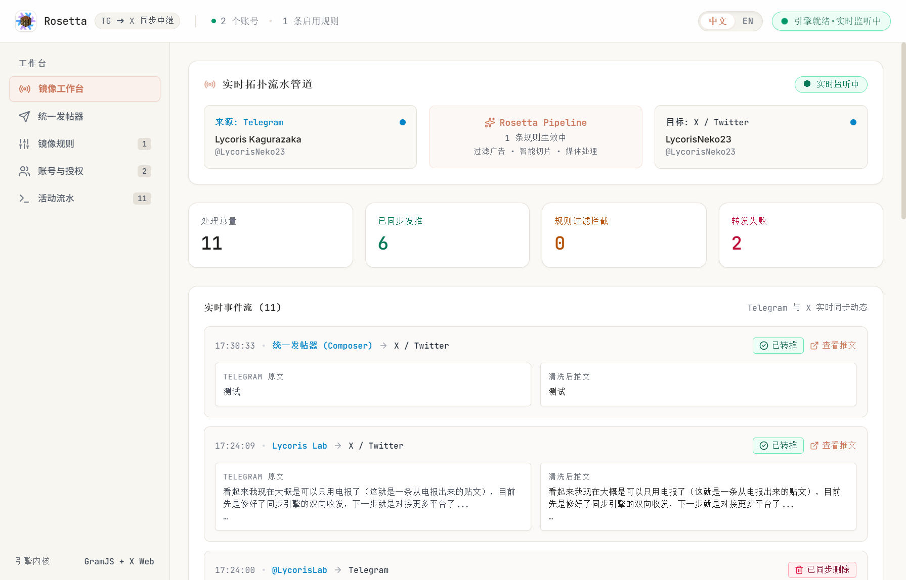

<div align="center">


# Rosetta

### 跨平台多渠道社交同步工作台 & Telegram 到 X (Twitter) 实时镜像中枢
**Modern Multi-Channel Social Workstation & Real-Time Telegram-to-X Channel Mirror**

[](https://www.electronjs.org/)
[](https://www.typescriptlang.org/)
[](https://react.dev/)
[](https://tailwindcss.com/)
[](LICENSE)

<br />



</div>

---

## 核心特性 (Key Features)

- **零官方 API 限制与零收费依赖 (Zero Paid API Dependency)**
  - **Telegram 端**：基于原生 MTProto 二进制长连接 (GramJS)，静默监听公开频道及私有频道更新，无需购买 Bot 商业套餐。
  - **X (Twitter) 端**：深度自研逆向 GraphQL 协议与原生 `x-client-transaction-id` 动态签名算法，摆脱 Twitter 每月数百美元的昂贵 API 限制。
- **开机即启 · 纯常驻静默监听 (Always-On Instant Startup)**
  - 启动后自动载入 Telegram MTProto 会话凭证并即时建立长连接，无需手动点击启动。
- **智能相册与多图一揽子打包 (Smart Media Albums Aggregation)**
  - 自动识别电报相册分组 (groupedId)，采用防抖聚合缓冲池将组图完整打包。
  - 推特单条推文优先支持发满 6 张图片；若受账号策略限制或图片超额，自适应将剩余图片通过回复线程 (Thread) 无损链式串联。
- **全局原生视频支持 (Full Video & Chunked Upload)**
  - Telegram 视频消息自动提取；推特端采用完整的 Chunked Media Upload (INIT -> APPEND -> FINALIZE -> STATUS 轮询) 协议，支持大体积高清 MP4/WebM 视频分片转码发布。
- **智能联动同步撤回 (Synchronized Deletion)**
  - 电报频道中撤回或删除任意消息，X / Twitter 对应的单推或长推推文串将即刻被自动联动删除，保持全网信息一致。
- **原生出处署名 (Smart Attribution Footers)**
  - 转发消息自动解析原作者或源频道：
    - 公开频道/用户：`RT: t.me/<username> 西元YYYY年M月D日 HH:mm`
    - 无公开用户名（纯昵称）：`RT: <DisplayName> 西元YYYY年M月D日 HH:mm`
- **实时活动流水与处理态 (Live Activity Stream with Processing States)**
  - 双重保底通信（IPC 广播 + 3 秒自动守护轮询）。
  - 发帖瞬间立即呈现处理中高频状态流动，并在完成后就地更新成功状态与直达推文链接。
- **双语极简 UI (Bilingual Claude Aesthetic UI)**
  - 内置中文/英文药丸形瞬时切换按钮，排版精致清爽。

---

## 架构概览 (Architecture)

```text
+--------------------------------------------------------+
|                   Rosetta Desktop (Electron)           |
+--------------------------+-----------------------------+
|  Renderer (React+Tailwind)|  Main Process (Node.js)     |
|  - 镜像工作台 (MirrorStudio) |  - Storage (rosetta-store)  |
|  - 统一发帖器 (Composer)     |  - ContentPipeline 过滤器    |
|  - 规则路由 (RulesManager)  |  - TelegramMirrorService    |
|  - 账号管理 (Accounts)      |  - TwitterDriver (GraphQL)  |
|  - 活动流水 (LogsView)      |  - Transaction Signer       |
+------------+-------------+--------------+--------------+
             |                            |
             v                            v
  Telegram MTProto (GramJS)      X / Twitter Web (GraphQL)
  [监听频道广播 / 相册 / 视频]    [发布单推 / 长推 / 线程 / 删帖]
```

---

## 快速上手 (Quick Start)

### 1. 环境准备 (Prerequisites)
- Node.js >= 18.0.0
- pnpm >= 9.0.0
- Telegram 开发者账号获取的 `API_ID` 与 `API_HASH` ([my.telegram.org](https://my.telegram.org/))

### 2. 克隆项目与安装依赖
```bash
git clone https://github.com/your-username/rosetta.git
cd rosetta

# 安装项目依赖
pnpm install
```

### 3. 开发模式启动
```bash
pnpm dev
```

### 4. 生产打包构建
```bash
# 类型检查与编译
pnpm build

# 打包为 Windows 可执行安装程序 (.exe)
pnpm build:win
```

---

## 配置指南 (Configuration)

1. **绑定 X / Twitter 账号**：
   - 进入「账号与授权」页面，点击「交互式登录 X / Twitter」。
   - 在弹出的官方登录窗中完成登录，Rosetta 将全自动静默提取安全凭据 (`auth_token` 与 `ct0`) 并完成安全保存。
2. **绑定 Telegram 账号**：
   - 输入您在 [my.telegram.org](https://my.telegram.org) 创建的 `API ID` 与 `API Hash`。
   - 输入手机号获取 Telegram 客户端验证码（支持 2FA 两步验证密码输入）。
3. **配置镜像规则**：
   - 在「镜像规则」中添加需要监听的源频道（支持 `@channel`、`https://t.me/channel` 或私有频道数字 ID）。
   - 选择目标推特账号，配置去广告关键字、话题标签过滤与自动推文拆分。
4. **即刻使用**：
   - 在电报频道中发布文字、相册图集或视频，X 端将即刻同步发布对应推文串。

---

## 目录结构 (Directory Structure)

```text
rosetta/
├── docs/                           # 预览图与技术物料
│   └── preview.png                 # 界面高清渲染图
├── resources/                      # 应用图标与原图物料
│   ├── logo.jpg                    # 工艺台 Logo 原图
│   └── icon.png                    # 高清图标
├── src/
│   ├── main/
│   │   ├── dispatcher/             # 多平台广播分发服务
│   │   ├── drivers/                # X Web GraphQL 协议与事务签名器
│   │   │   ├── twitter-transaction.ts # 纯 TS 无依赖动态签名生成器
│   │   │   └── twitter.ts          # 推文/相册/分片视频/撤回驱动
│   │   ├── mirror/                 # 镜像引擎与相册聚合池
│   │   │   ├── pipeline.ts         # 文本管道、出处署名与分块
│   │   │   └── telegram-listener.ts# MTProto 消息监听与删除联动
│   │   ├── storage/                # 本地持久化存储 (Store)
│   │   ├── index.ts                # Electron 主进程入口
│   │   └── ipc.ts                  # 全局 IPC 通信通道
│   ├── preload/                    # 安全上下文隔离 Preload 桥接
│   ├── renderer/src/
│   │   ├── components/             # 界面组件 (工作台/发帖器/规则/账号/日志)
│   │   ├── i18n/                   # 中英双语多语言词条
│   │   ├── App.tsx                 # 前端根容器
│   │   └── main.tsx                # React 渲染入口
│   └── shared/                     # 前后端共用类型定义 (TypeScript)
├── package.json
└── electron.vite.config.ts
```

---

## 隐私与安全性 (Security & Privacy)

- **完全本地化**：所有账号密码、Session 会话凭证及规则流水均仅保存在本地用户应用数据目录 (`%APPDATA%/rosetta/rosetta-store.json`)，绝不向任何第三方服务器上传任何凭证。
- **抗风险保障**：逆向调用均模拟真实 Chrome 浏览器特征及安全请求头，支持自动故障回退与自适应降级。

---

## 开源许可证 (License)

本项目采用 [MIT License](LICENSE) 开源许可证。
