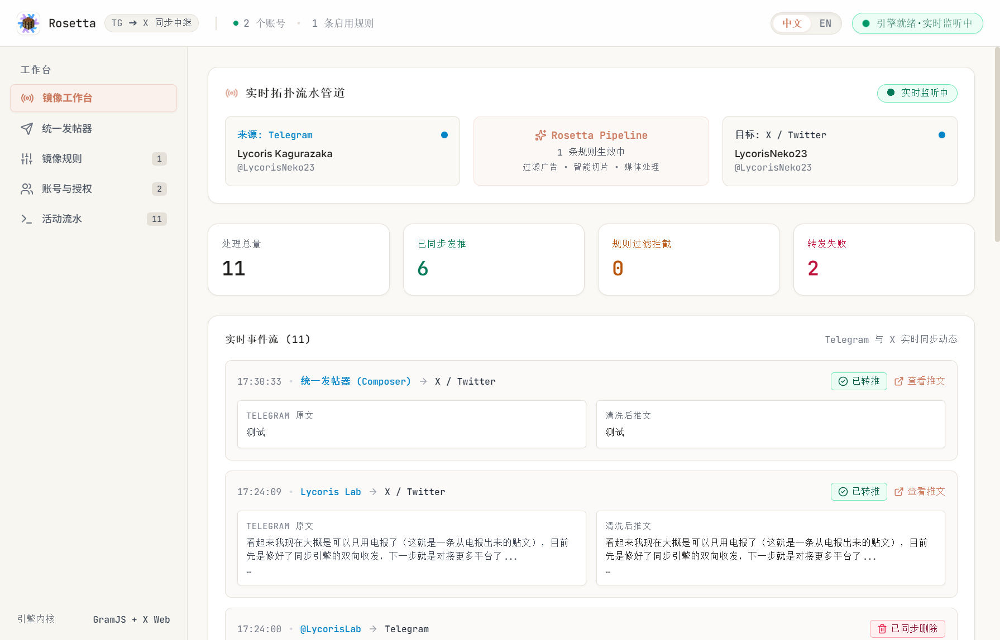

<div align="center">


# Rosetta

[](https://github.com/LycorisNeko/rosetta/actions)
[](https://www.electronjs.org/)
[](https://www.typescriptlang.org/)
[](https://react.dev/)
[](https://tailwindcss.com/)
[](https://github.com/LycorisNeko/rosetta/releases)
[](LICENSE)

<br />

<b>A headless-protocol social sync hub & real-time channel mirror workstation crafted with Electron and TypeScript.</b>

<br />

[English](README_EN.md) • [简体中文](README.md)

<br />



</div>

---

## What It Actually Does

### **Mirroring, Listening & Retweeting**
- **Native MTProto binary connection**: Stays silently online via the raw protocol without polling overhead; channel posts reach the pipeline in milliseconds without paying for commercial Bot tiers.
- **Debounced album grouping**: Locks onto Telegram's `groupedId` tags with an elastic 2500ms buffering window; pieces are assembled and packed before dispatch, preventing fragmented single-image tweets.
- **Adaptive thread chaining**: Fills up to 6 photos per single tweet on X; when media exceeds limits or text runs long, posts automatically split across threaded reply chains.
- **Chunked video uploads**: Extracts MP4 streams directly from Telegram messages; implements X's complete Chunked Media protocol (`INIT` → `APPEND` → `FINALIZE`), monitoring transcode completion before firing the tweet.
- **Attribution & timestamp stamps**: Automatically traces forward origins; public usernames get tagged with `RT: t.me/<channel>`, private forwards keep display names, and every post ends with an exact Gregorian timestamp.

### **Unified Broadcasting**
- **Dual-platform or isolated dispatch**: Choose between X, Telegram, or both simultaneously in Composer; hit Enter once and posts reach all destinations synchronously.
- **Sentence-boundary text chunking**: Long posts slice naturally along punctuation boundaries; real-time preview displays numbering and paragraph structure before publishing.
- **Interactive Telegram bot sessions**: Message your private bot with `/start` from your mobile client to queue media and text; confirm from your phone to publish directly to X.

### **Craft & Dual-Language Interface**
- **Warm paper aesthetic**: Replaces harsh white glare with low-contrast warm paper tones; breathable layout keeps prolonged monitoring easy on the eyes.
- **Zero-reload bilingual toggle**: Switch between Chinese and English instantly across all 9 workstation views without page refreshes or losing draft text.
- **Live activity pipeline**: Real-time indicators display connection status and processing state with direct post-publication links.

### **Under-the-Hood Engineering**
- **Pure TypeScript transaction signer**: Reverse-engineers X's client-side transaction logic with a pure mathematical Bézier solver; eliminates headless browser DOM requirements and expensive official API bills.
- **Resilient IPC pipeline**: Combines event-driven IPC broadcasts with a 3-second watchdog timer to recover state cleanly after system sleep cycles.
- **Local-first credential sandbox**: No middleman servers; all sessions, auth tokens, rules, and activity logs remain strictly on your local disk.
- **Targeted post retraction**: Dedicated deletion hub pulls the last 5 posts from either platform for manual remote removal.

---

## Getting Started

### Prerequisites
- Node.js `>= 18.0.0` (Recommended: `20.x`)
- pnpm `>= 9.0.0`
- Windows 10 / 11 64-bit
- Telegram API credentials (`API_ID` & `API_HASH` from [my.telegram.org](https://my.telegram.org))

### Quick Run

```bash
# 1. Clone repository
git clone https://github.com/LycorisNeko/rosetta.git
cd rosetta

# 2. Install dependencies
pnpm install

# 3. Launch dev workstation
pnpm dev
```

### Production Notes & Gotchas
- **DOM-free signing engine**: The transaction signer runs without `linkedom` or `jsdom` dependencies, avoiding bundle crashes in production Electron environments.
- **Local state reset**: To wipe all local configuration and credentials back to factory defaults:
  ```bash
  rmdir /s /q "%APPDATA%\rosetta"
  ```

---

## Release Artifacts

### Platform Builds

| Artifact | Architecture | Type | Notes |
| :--- | :--- | :--- | :--- |
| `Rosetta-Setup-0.2.10-x64.exe` | Windows x64 | NSIS Installer | Configurable installation directory with desktop shortcut |
| `Rosetta-Portable-0.2.10-x64.exe` | Windows x64 | Portable | Single executable; runs without installation |

### Windows Notes
- **SmartScreen warning**: Open-source builds do not include paid EV code signing certificates. If prompted by Windows Defender SmartScreen, choose "More info" → "Run anyway".
- **Network routing**: Ensure local proxy or TUN virtual network adapters route Electron process traffic to access Telegram MTProto and X endpoints.

---

## Credits & Acknowledgments

- [GramJS (telegram)](https://github.com/gram-js/gramjs) - Clean native MTProto implementation
- [electron-vite](https://github.com/alex8088/electron-vite) - Streamlined modern Electron build workflow
- [Lucide Icons](https://lucide.dev/) - Crisp and consistent linear icon set
- [Tailwind CSS](https://tailwindcss.com/) - Utility-first styling framework
- And you, looking at this screen right now

---

<div align="center">


<sub>Rosetta is open-sourced under the MIT License. Third-party brand marks (Telegram, X/Twitter) belong to their respective owners.</sub>

</div>
